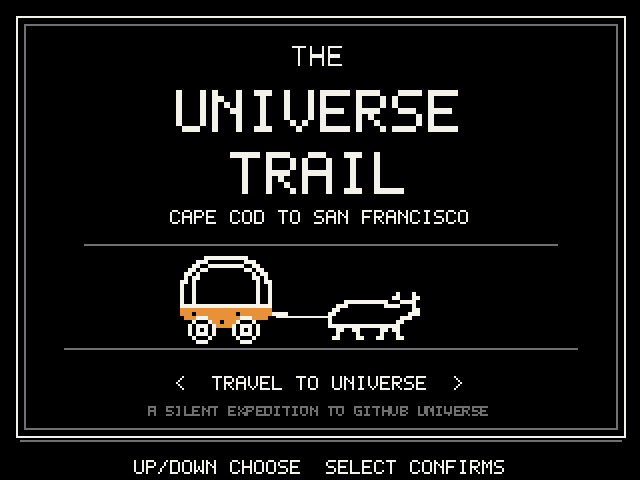
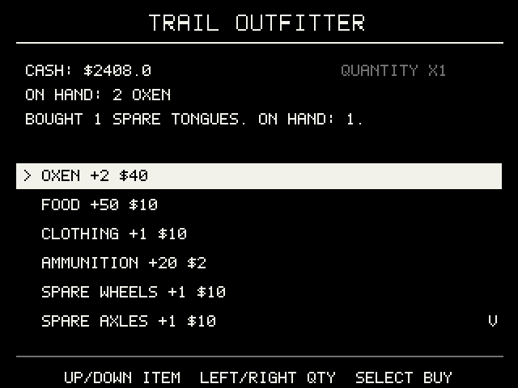
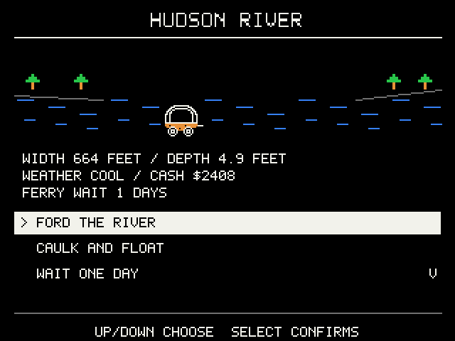

# Universe Trail for the GitHub Universe Badge

Five travelers. One wagon. A continent between Cape Cod and GitHub Universe.
A silent, button-driven expedition with original code, writing and pixel art,
inspired by classic 1985 wagon-trail mechanics.

Choose an occupation, name your party, buy supplies and set out for San Francisco.
Manage pace and rations, cross rivers, trade, hunt, repair the wagon and keep your
travelers alive. The route is fictional; this is a game, not a navigation guide.

Your expedition saves on the badge. Optional white case-light effects and
conference reminder cards share the same control style as Fallout. This package
contains no personal agenda, employer branding or real traveler identities.

## From outfitter to riverbank

| Start your expedition | Stock the wagon | Choose a crossing |
| --- | --- | --- |
|  |  |  |

Simulator screenshots rendered from the included app code at 2× its native
320 × 240 resolution. The river screen uses a deterministic example expedition;
no personal traveler names or saved game were loaded.

## Install in five steps

You need a **GitHub Universe 2026 Badger 2350 badge**, its supplied firmware and a
USB cable that carries data. No firmware flashing or Python installation is
needed for the direct-folder method.

1. Download this repository using **Code → Download ZIP**, then extract it.
2. Open the badge's supplied **USB Disk / Mass Storage** app and connect USB.
   A drive named **BADGER** should appear. Copy its current contents somewhere
   safe before making changes.
3. Open the extracted repository's `apps` folder. Copy only **`universe_trail`** into
   **`BADGER/apps/`**. Keep the whole folder, including `__init__.py`, modules,
   icon and assets. The final path must be:

   ```text
   BADGER/
   └── apps/
       └── universe_trail/
           ├── __init__.py
           ├── core.py
           └── ...all other supplied files
   ```

4. Wait for copying to finish, safely eject **BADGER**, then reset/restart the
   badge normally.
5. Open **Universe Trail** from the supplied launcher.

**Keep every existing stock app and file.** Do not replace `main.py`, format the
drive, flash a UF2, or touch `secrets.py`, Wi-Fi credentials or stock settings.
Do not copy this repository's README, tests or tools onto the badge. If your USB
volume has a different layout, stop and inspect its existing apps location rather
than creating a guessed second system tree.

### Updating, rolling back and removing

Before an update, copy any existing `apps/universe_trail/` folder off the badge, including
any local `config.json`. Replace only that custom app folder. Reapply your own
configuration separately; never overwrite it with someone else's profile.

To roll back, restore the previous custom app folder. To uninstall, remove only
`apps/universe_trail/`. Neither action requires changing the stock launcher or secrets.
Save data lives outside the app folder in `/state/` and may not be exposed on the
USB drive. Do not delete saves unless you intentionally want to reset progress.
Wait at least two seconds after changing settings, or use Home to save before
removing power. USB removal is safe after the host has finished copying/ejecting.

## Controls and everyday use

| Control | Action |
| --- | --- |
| Up / Down | Select a menu option |
| Select | Confirm; open camp while traveling |
| Left / Right | Contextual controls, including hunting movement |
| Home | Save and return to the supplied launcher |

Choose **Travel to Universe**, an occupation and party names, then select a departure
month and buy supplies. You need oxen and food before setting out. Camp provides
access to supplies, pace, rations, rest, hunting and the journal. Read the in-game
help for river crossing, hunting and wagon repair controls.

**Lights / Reminders** appears in the title and camp menus. Decorative lights
default to Off. Brightness Off disables all case lights, including reminders.
Reminders are optional and this package ships with no agenda. During
a reminder, Select dismisses and Down snoozes; the expedition pauses. A correct
badge clock and an awake custom app are required. Automatic ECO mode is currently
a Fallout feature, not a Trail feature.

## Build and test from source

Python 3.9+ is needed only for local development and packaging. No external Python
dependencies are required:

```sh
python3 -m unittest discover -s tests -v
python3 build.py
```

The build creates `dist/universe_trail-badge.zip` with only the allowlisted app, install
instructions, screenshots and linked documentation. Extract it and copy
`apps/universe_trail` using the steps above. Personal configuration, credentials and
save files are excluded from the build allowlist.
Keep the documentation and screenshots with the download for reference. Copy
only the app folder to the badge.

Runtime code lives in `apps/universe_trail/`; portable logic is in `core.py`.
The app is self-contained and does not require either of the other two custom apps. Stock
firmware is a device prerequisite and is deliberately not redistributed here.

## Compatibility and troubleshooting

The runtime was exercised on the delivered Universe 2026 Badger 2350, with its
stock MonaOS 4.0 launcher and MicroPython 1.29.0-preview firmware build
`v1.14-6911.g2e1a6ab1ed.dirty`. The sanitized repository's defaults and build are
also tested locally. Older badges and other firmware versions are not verified.

- **No BADGER drive:** use a data-capable cable and open USB Disk / Mass Storage.
- **App missing:** check the exact folder path above; avoid double-nested folders.
- **Blank screen or import error:** verify every module and asset was copied,
  safely eject and restart. Keep the traceback if you need help diagnosing it.
- **Unexpected settings after an update:** saved preferences are intentionally
  preserved and may differ from fresh-install defaults.
- **No colored case lights:** the badge's case LEDs are white; screen colors are
  unrelated. Check the app's brightness/decorative-light settings.

The download contains this custom app, generic defaults, tests and documentation.
Stock firmware, personal agendas, credentials, device backups and browser sessions
are excluded.

## Credits and maintenance

**Created with AI by DChevrier1.** See [NOTICE.md](NOTICE.md) for artwork, map and
trademark provenance. This is an unofficial custom app, not an official firmware
release. Third-party artwork and marks retain their owners' rights.

For each change, update the README and in-app help, run the checks above, and
keep documentation screenshots aligned with the included app. Keep personal
configuration and save data outside version control.
